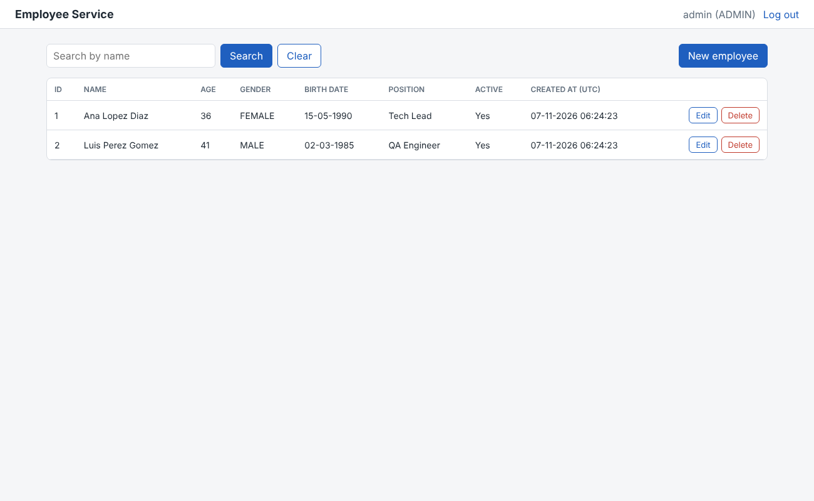
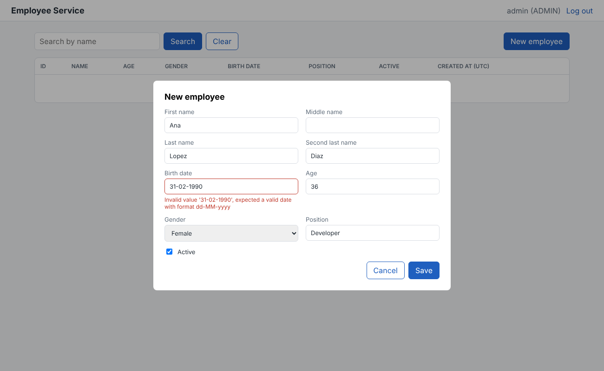
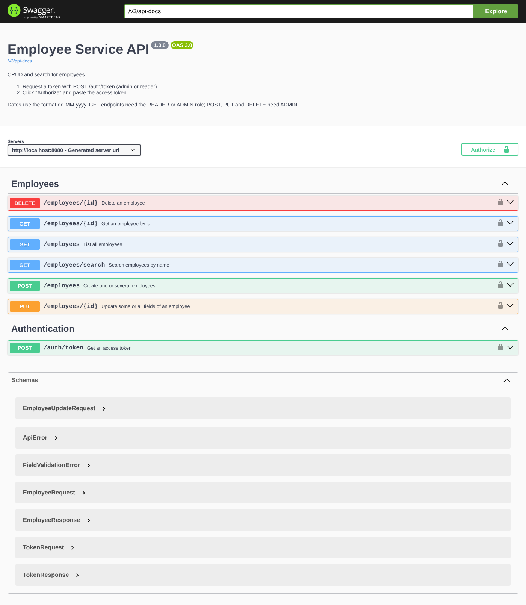

# Evidencias

Ejecución del 7 de noviembre de 2026.

## Pruebas automáticas (`./mvnw verify`)

| Clase | Tests | Fallos |
|---|---|---|
| EmployeeValidationTest | 32 | 0 |
| EmployeeServiceImplTest | 15 | 0 |
| EmployeeControllerTest | 13 | 0 |
| EmployeeApiIntegrationTest | 6 | 0 |
| EmployeeRepositoryTest | 5 | 0 |
| AgeCalculatorTest | 4 | 0 |
| EmployeeServiceApplicationTests | 1 | 0 |
| **Total** | **76** | **0** |

Cobertura de líneas (JaCoCo): **93.6 %**. El build falla si baja de 80 %.
El reporte HTML queda en `target/site/jacoco/index.html`.

## Colección Postman (perfil `local`)

21 peticiones, todas con el status esperado:

```
OK  200 Auth / Admin token
OK  200 Auth / Reader token
OK  401 Auth / Wrong password
OK  201 Employees / Create one
OK  201 Employees / Create many
OK  200 Employees / Get all
OK  200 Employees / Get by id
OK  200 Employees / Search by name
OK  200 Employees / Partial update
OK  204 Employees / Delete
OK  404 Employees / Get deleted (404)
OK  400 Errors / Invalid date (400)
OK  400 Errors / Invalid gender (400)
OK  400 Errors / Age does not match birthDate (400)
OK  409 Errors / Duplicate (409)
OK  400 Errors / Empty update (400)
OK  400 Errors / Search too short (400)
OK  403 Errors / Reader cannot create (403)
OK  401 Errors / No token (401)
OK  200 Monitoring / Health
OK  200 Monitoring / Info
```

## Docker Compose con MySQL 8.4

```
NAME               IMAGE                    STATUS
employee-service   employee-service:1.0.0   Up (healthy)   0.0.0.0:8080->8080/tcp
employees-mysql    mysql:8.4                Up (healthy)   0.0.0.0:3306->3306/tcp
```

```
$ curl -s localhost:8080/actuator/health
{"status":"UP","groups":["liveness","readiness"]}
```

Registro guardado en MySQL y migración aplicada por Flyway:

```
id  first_name  created_at
1   Ana         2026-11-07 05:15:06.693118

version  description            success
1        create employee table  1
```

Log de la petición, con el token enmascarado:

```
2026-11-07 05:15:06.710  INFO [0ed10cdc-dcae-4db5-9958-0f62717b3750] c.i.e.logging.RequestLoggingFilter - POST /employees -> 201 (124 ms) headers={accept=*/*, authorization=***, content-length=139, content-type=application/json, host=localhost:8080, user-agent=curl/8.5.0}
```

## Interfaz web

Video de la demo (1 minuto, con subtítulos): [demo.mp4](demo.mp4)





## Swagger UI


